# Sapphire public graphics

This page is generated from the repository's verified `graphics/` tree. Japanese and Korean assets are listed before English and other official languages.

## Header

| Preview | File | Language | Size | SHA-256 |
| --- | --- | --- | --- | --- |
|  | [`graphics/header/nintendo-logo.png`](graphics/header/nintendo-logo.png) | Unspecified | 416x64 | `f07daf6e489d64b7...` |

## Pokemon

| Preview | File | Language | Size | SHA-256 |
| --- | --- | --- | --- | --- |
| 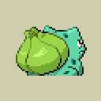 | [`graphics/pokemon/bulbasaur-back-axp-j-rev0-retail.png`](graphics/pokemon/bulbasaur-back-axp-j-rev0-retail.png) | Japanese | 128x128 | `a56ef8e9a9b690fc...` |
| 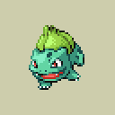 | [`graphics/pokemon/bulbasaur-front-axp-j-rev0-retail.png`](graphics/pokemon/bulbasaur-front-axp-j-rev0-retail.png) | Japanese | 128x128 | `8a325c6541282fa7...` |
|  | [`graphics/pokemon/charmander-back-axp-j-rev0-retail.png`](graphics/pokemon/charmander-back-axp-j-rev0-retail.png) | Japanese | 128x128 | `0521ce266d4c527f...` |
| 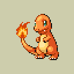 | [`graphics/pokemon/charmander-front-axp-j-rev0-retail.png`](graphics/pokemon/charmander-front-axp-j-rev0-retail.png) | Japanese | 128x128 | `c2521fd7f5d54944...` |
| 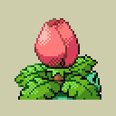 | [`graphics/pokemon/ivysaur-back-axp-j-rev0-retail.png`](graphics/pokemon/ivysaur-back-axp-j-rev0-retail.png) | Japanese | 128x128 | `57f839867dfb4f04...` |
|  | [`graphics/pokemon/ivysaur-front-axp-j-rev0-retail.png`](graphics/pokemon/ivysaur-front-axp-j-rev0-retail.png) | Japanese | 128x128 | `317ca13389c4a268...` |
|  | [`graphics/pokemon/kyogre-back-axp-j-rev0-retail.png`](graphics/pokemon/kyogre-back-axp-j-rev0-retail.png) | Japanese | 128x128 | `e737246afb840858...` |
|  | [`graphics/pokemon/kyogre-front-axp-j-rev0-retail.png`](graphics/pokemon/kyogre-front-axp-j-rev0-retail.png) | Japanese | 128x128 | `6d0b17a5743a73c7...` |
|  | [`graphics/pokemon/pikachu-back-axp-j-rev0-retail.png`](graphics/pokemon/pikachu-back-axp-j-rev0-retail.png) | Japanese | 128x128 | `d1472dd2f4862fe9...` |
|  | [`graphics/pokemon/pikachu-front-axp-j-rev0-retail.png`](graphics/pokemon/pikachu-front-axp-j-rev0-retail.png) | Japanese | 128x128 | `0be25ad9c369dfb5...` |
| 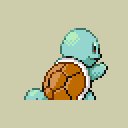 | [`graphics/pokemon/squirtle-back-axp-j-rev0-retail.png`](graphics/pokemon/squirtle-back-axp-j-rev0-retail.png) | Japanese | 128x128 | `c80710c9b72dc8c6...` |
|  | [`graphics/pokemon/squirtle-front-axp-j-rev0-retail.png`](graphics/pokemon/squirtle-front-axp-j-rev0-retail.png) | Japanese | 128x128 | `867c957520288232...` |
|  | [`graphics/pokemon/venusaur-back-axp-j-rev0-retail.png`](graphics/pokemon/venusaur-back-axp-j-rev0-retail.png) | Japanese | 128x128 | `8467656ef54308b2...` |
|  | [`graphics/pokemon/venusaur-front-axp-j-rev0-retail.png`](graphics/pokemon/venusaur-front-axp-j-rev0-retail.png) | Japanese | 128x128 | `9c6f9fdb302031aa...` |
|  | [`graphics/pokemon/bulbasaur-back-axp-e-rev0-retail.png`](graphics/pokemon/bulbasaur-back-axp-e-rev0-retail.png) | English | 128x128 | `a56ef8e9a9b690fc...` |
|  | [`graphics/pokemon/bulbasaur-back-axp-e-rev1-retail.png`](graphics/pokemon/bulbasaur-back-axp-e-rev1-retail.png) | English | 128x128 | `a56ef8e9a9b690fc...` |
|  | [`graphics/pokemon/bulbasaur-back-axp-e-rev2-retail.png`](graphics/pokemon/bulbasaur-back-axp-e-rev2-retail.png) | English | 128x128 | `a56ef8e9a9b690fc...` |
|  | [`graphics/pokemon/bulbasaur-front-axp-e-rev0-retail.png`](graphics/pokemon/bulbasaur-front-axp-e-rev0-retail.png) | English | 128x128 | `8a325c6541282fa7...` |
|  | [`graphics/pokemon/bulbasaur-front-axp-e-rev1-retail.png`](graphics/pokemon/bulbasaur-front-axp-e-rev1-retail.png) | English | 128x128 | `8a325c6541282fa7...` |
|  | [`graphics/pokemon/bulbasaur-front-axp-e-rev2-retail.png`](graphics/pokemon/bulbasaur-front-axp-e-rev2-retail.png) | English | 128x128 | `8a325c6541282fa7...` |
|  | [`graphics/pokemon/charmander-back-axp-e-rev0-retail.png`](graphics/pokemon/charmander-back-axp-e-rev0-retail.png) | English | 128x128 | `0521ce266d4c527f...` |
|  | [`graphics/pokemon/charmander-back-axp-e-rev1-retail.png`](graphics/pokemon/charmander-back-axp-e-rev1-retail.png) | English | 128x128 | `0521ce266d4c527f...` |
|  | [`graphics/pokemon/charmander-back-axp-e-rev2-retail.png`](graphics/pokemon/charmander-back-axp-e-rev2-retail.png) | English | 128x128 | `0521ce266d4c527f...` |
|  | [`graphics/pokemon/charmander-front-axp-e-rev0-retail.png`](graphics/pokemon/charmander-front-axp-e-rev0-retail.png) | English | 128x128 | `c2521fd7f5d54944...` |
|  | [`graphics/pokemon/charmander-front-axp-e-rev1-retail.png`](graphics/pokemon/charmander-front-axp-e-rev1-retail.png) | English | 128x128 | `c2521fd7f5d54944...` |
|  | [`graphics/pokemon/charmander-front-axp-e-rev2-retail.png`](graphics/pokemon/charmander-front-axp-e-rev2-retail.png) | English | 128x128 | `c2521fd7f5d54944...` |
|  | [`graphics/pokemon/ivysaur-back-axp-e-rev0-retail.png`](graphics/pokemon/ivysaur-back-axp-e-rev0-retail.png) | English | 128x128 | `57f839867dfb4f04...` |
|  | [`graphics/pokemon/ivysaur-back-axp-e-rev1-retail.png`](graphics/pokemon/ivysaur-back-axp-e-rev1-retail.png) | English | 128x128 | `57f839867dfb4f04...` |
|  | [`graphics/pokemon/ivysaur-back-axp-e-rev2-retail.png`](graphics/pokemon/ivysaur-back-axp-e-rev2-retail.png) | English | 128x128 | `57f839867dfb4f04...` |
|  | [`graphics/pokemon/ivysaur-front-axp-e-rev0-retail.png`](graphics/pokemon/ivysaur-front-axp-e-rev0-retail.png) | English | 128x128 | `317ca13389c4a268...` |
|  | [`graphics/pokemon/ivysaur-front-axp-e-rev1-retail.png`](graphics/pokemon/ivysaur-front-axp-e-rev1-retail.png) | English | 128x128 | `317ca13389c4a268...` |
|  | [`graphics/pokemon/ivysaur-front-axp-e-rev2-retail.png`](graphics/pokemon/ivysaur-front-axp-e-rev2-retail.png) | English | 128x128 | `317ca13389c4a268...` |
|  | [`graphics/pokemon/kyogre-back-axp-e-rev0-retail.png`](graphics/pokemon/kyogre-back-axp-e-rev0-retail.png) | English | 128x128 | `e737246afb840858...` |
|  | [`graphics/pokemon/kyogre-back-axp-e-rev1-retail.png`](graphics/pokemon/kyogre-back-axp-e-rev1-retail.png) | English | 128x128 | `e737246afb840858...` |
|  | [`graphics/pokemon/kyogre-back-axp-e-rev2-retail.png`](graphics/pokemon/kyogre-back-axp-e-rev2-retail.png) | English | 128x128 | `e737246afb840858...` |
|  | [`graphics/pokemon/kyogre-front-axp-e-rev0-retail.png`](graphics/pokemon/kyogre-front-axp-e-rev0-retail.png) | English | 128x128 | `6d0b17a5743a73c7...` |
|  | [`graphics/pokemon/kyogre-front-axp-e-rev1-retail.png`](graphics/pokemon/kyogre-front-axp-e-rev1-retail.png) | English | 128x128 | `6d0b17a5743a73c7...` |
|  | [`graphics/pokemon/kyogre-front-axp-e-rev2-retail.png`](graphics/pokemon/kyogre-front-axp-e-rev2-retail.png) | English | 128x128 | `6d0b17a5743a73c7...` |
|  | [`graphics/pokemon/pikachu-back-axp-e-rev0-retail.png`](graphics/pokemon/pikachu-back-axp-e-rev0-retail.png) | English | 128x128 | `d1472dd2f4862fe9...` |
|  | [`graphics/pokemon/pikachu-back-axp-e-rev1-retail.png`](graphics/pokemon/pikachu-back-axp-e-rev1-retail.png) | English | 128x128 | `d1472dd2f4862fe9...` |
|  | [`graphics/pokemon/pikachu-back-axp-e-rev2-retail.png`](graphics/pokemon/pikachu-back-axp-e-rev2-retail.png) | English | 128x128 | `d1472dd2f4862fe9...` |
|  | [`graphics/pokemon/pikachu-front-axp-e-rev0-retail.png`](graphics/pokemon/pikachu-front-axp-e-rev0-retail.png) | English | 128x128 | `0be25ad9c369dfb5...` |
|  | [`graphics/pokemon/pikachu-front-axp-e-rev1-retail.png`](graphics/pokemon/pikachu-front-axp-e-rev1-retail.png) | English | 128x128 | `0be25ad9c369dfb5...` |
|  | [`graphics/pokemon/pikachu-front-axp-e-rev2-retail.png`](graphics/pokemon/pikachu-front-axp-e-rev2-retail.png) | English | 128x128 | `0be25ad9c369dfb5...` |
|  | [`graphics/pokemon/squirtle-back-axp-e-rev0-retail.png`](graphics/pokemon/squirtle-back-axp-e-rev0-retail.png) | English | 128x128 | `c80710c9b72dc8c6...` |
|  | [`graphics/pokemon/squirtle-back-axp-e-rev1-retail.png`](graphics/pokemon/squirtle-back-axp-e-rev1-retail.png) | English | 128x128 | `c80710c9b72dc8c6...` |
|  | [`graphics/pokemon/squirtle-back-axp-e-rev2-retail.png`](graphics/pokemon/squirtle-back-axp-e-rev2-retail.png) | English | 128x128 | `c80710c9b72dc8c6...` |
|  | [`graphics/pokemon/squirtle-front-axp-e-rev0-retail.png`](graphics/pokemon/squirtle-front-axp-e-rev0-retail.png) | English | 128x128 | `867c957520288232...` |
|  | [`graphics/pokemon/squirtle-front-axp-e-rev1-retail.png`](graphics/pokemon/squirtle-front-axp-e-rev1-retail.png) | English | 128x128 | `867c957520288232...` |
|  | [`graphics/pokemon/squirtle-front-axp-e-rev2-retail.png`](graphics/pokemon/squirtle-front-axp-e-rev2-retail.png) | English | 128x128 | `867c957520288232...` |
|  | [`graphics/pokemon/venusaur-back-axp-e-rev0-retail.png`](graphics/pokemon/venusaur-back-axp-e-rev0-retail.png) | English | 128x128 | `8467656ef54308b2...` |
|  | [`graphics/pokemon/venusaur-back-axp-e-rev1-retail.png`](graphics/pokemon/venusaur-back-axp-e-rev1-retail.png) | English | 128x128 | `8467656ef54308b2...` |
|  | [`graphics/pokemon/venusaur-back-axp-e-rev2-retail.png`](graphics/pokemon/venusaur-back-axp-e-rev2-retail.png) | English | 128x128 | `8467656ef54308b2...` |
|  | [`graphics/pokemon/venusaur-front-axp-e-rev0-retail.png`](graphics/pokemon/venusaur-front-axp-e-rev0-retail.png) | English | 128x128 | `9c6f9fdb302031aa...` |
|  | [`graphics/pokemon/venusaur-front-axp-e-rev1-retail.png`](graphics/pokemon/venusaur-front-axp-e-rev1-retail.png) | English | 128x128 | `9c6f9fdb302031aa...` |
|  | [`graphics/pokemon/venusaur-front-axp-e-rev2-retail.png`](graphics/pokemon/venusaur-front-axp-e-rev2-retail.png) | English | 128x128 | `9c6f9fdb302031aa...` |
|  | [`graphics/pokemon/bulbasaur-back-axp-d-rev0-retail.png`](graphics/pokemon/bulbasaur-back-axp-d-rev0-retail.png) | German | 128x128 | `a56ef8e9a9b690fc...` |
|  | [`graphics/pokemon/bulbasaur-back-axp-d-rev1-retail.png`](graphics/pokemon/bulbasaur-back-axp-d-rev1-retail.png) | German | 128x128 | `a56ef8e9a9b690fc...` |
|  | [`graphics/pokemon/bulbasaur-front-axp-d-rev0-retail.png`](graphics/pokemon/bulbasaur-front-axp-d-rev0-retail.png) | German | 128x128 | `8a325c6541282fa7...` |
|  | [`graphics/pokemon/bulbasaur-front-axp-d-rev1-retail.png`](graphics/pokemon/bulbasaur-front-axp-d-rev1-retail.png) | German | 128x128 | `8a325c6541282fa7...` |
| 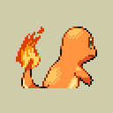 | [`graphics/pokemon/charmander-back-axp-d-rev0-retail.png`](graphics/pokemon/charmander-back-axp-d-rev0-retail.png) | German | 128x128 | `0521ce266d4c527f...` |
|  | [`graphics/pokemon/charmander-back-axp-d-rev1-retail.png`](graphics/pokemon/charmander-back-axp-d-rev1-retail.png) | German | 128x128 | `0521ce266d4c527f...` |
|  | [`graphics/pokemon/charmander-front-axp-d-rev0-retail.png`](graphics/pokemon/charmander-front-axp-d-rev0-retail.png) | German | 128x128 | `c2521fd7f5d54944...` |
|  | [`graphics/pokemon/charmander-front-axp-d-rev1-retail.png`](graphics/pokemon/charmander-front-axp-d-rev1-retail.png) | German | 128x128 | `c2521fd7f5d54944...` |
|  | [`graphics/pokemon/ivysaur-back-axp-d-rev0-retail.png`](graphics/pokemon/ivysaur-back-axp-d-rev0-retail.png) | German | 128x128 | `57f839867dfb4f04...` |
|  | [`graphics/pokemon/ivysaur-back-axp-d-rev1-retail.png`](graphics/pokemon/ivysaur-back-axp-d-rev1-retail.png) | German | 128x128 | `57f839867dfb4f04...` |
|  | [`graphics/pokemon/ivysaur-front-axp-d-rev0-retail.png`](graphics/pokemon/ivysaur-front-axp-d-rev0-retail.png) | German | 128x128 | `317ca13389c4a268...` |
|  | [`graphics/pokemon/ivysaur-front-axp-d-rev1-retail.png`](graphics/pokemon/ivysaur-front-axp-d-rev1-retail.png) | German | 128x128 | `317ca13389c4a268...` |
|  | [`graphics/pokemon/kyogre-back-axp-d-rev0-retail.png`](graphics/pokemon/kyogre-back-axp-d-rev0-retail.png) | German | 128x128 | `e737246afb840858...` |
|  | [`graphics/pokemon/kyogre-back-axp-d-rev1-retail.png`](graphics/pokemon/kyogre-back-axp-d-rev1-retail.png) | German | 128x128 | `e737246afb840858...` |
|  | [`graphics/pokemon/kyogre-front-axp-d-rev0-retail.png`](graphics/pokemon/kyogre-front-axp-d-rev0-retail.png) | German | 128x128 | `6d0b17a5743a73c7...` |
|  | [`graphics/pokemon/kyogre-front-axp-d-rev1-retail.png`](graphics/pokemon/kyogre-front-axp-d-rev1-retail.png) | German | 128x128 | `6d0b17a5743a73c7...` |
|  | [`graphics/pokemon/pikachu-back-axp-d-rev0-retail.png`](graphics/pokemon/pikachu-back-axp-d-rev0-retail.png) | German | 128x128 | `d1472dd2f4862fe9...` |
|  | [`graphics/pokemon/pikachu-back-axp-d-rev1-retail.png`](graphics/pokemon/pikachu-back-axp-d-rev1-retail.png) | German | 128x128 | `d1472dd2f4862fe9...` |
|  | [`graphics/pokemon/pikachu-front-axp-d-rev0-retail.png`](graphics/pokemon/pikachu-front-axp-d-rev0-retail.png) | German | 128x128 | `0be25ad9c369dfb5...` |
|  | [`graphics/pokemon/pikachu-front-axp-d-rev1-retail.png`](graphics/pokemon/pikachu-front-axp-d-rev1-retail.png) | German | 128x128 | `0be25ad9c369dfb5...` |
|  | [`graphics/pokemon/squirtle-back-axp-d-rev0-retail.png`](graphics/pokemon/squirtle-back-axp-d-rev0-retail.png) | German | 128x128 | `c80710c9b72dc8c6...` |
|  | [`graphics/pokemon/squirtle-back-axp-d-rev1-retail.png`](graphics/pokemon/squirtle-back-axp-d-rev1-retail.png) | German | 128x128 | `c80710c9b72dc8c6...` |
|  | [`graphics/pokemon/squirtle-front-axp-d-rev0-retail.png`](graphics/pokemon/squirtle-front-axp-d-rev0-retail.png) | German | 128x128 | `867c957520288232...` |
|  | [`graphics/pokemon/squirtle-front-axp-d-rev1-retail.png`](graphics/pokemon/squirtle-front-axp-d-rev1-retail.png) | German | 128x128 | `867c957520288232...` |
|  | [`graphics/pokemon/venusaur-back-axp-d-rev0-retail.png`](graphics/pokemon/venusaur-back-axp-d-rev0-retail.png) | German | 128x128 | `8467656ef54308b2...` |
|  | [`graphics/pokemon/venusaur-back-axp-d-rev1-retail.png`](graphics/pokemon/venusaur-back-axp-d-rev1-retail.png) | German | 128x128 | `8467656ef54308b2...` |
|  | [`graphics/pokemon/venusaur-front-axp-d-rev0-retail.png`](graphics/pokemon/venusaur-front-axp-d-rev0-retail.png) | German | 128x128 | `9c6f9fdb302031aa...` |
|  | [`graphics/pokemon/venusaur-front-axp-d-rev1-retail.png`](graphics/pokemon/venusaur-front-axp-d-rev1-retail.png) | German | 128x128 | `9c6f9fdb302031aa...` |
|  | [`graphics/pokemon/bulbasaur-back-axp-f-rev0-retail.png`](graphics/pokemon/bulbasaur-back-axp-f-rev0-retail.png) | French | 128x128 | `a56ef8e9a9b690fc...` |
|  | [`graphics/pokemon/bulbasaur-back-axp-f-rev1-retail.png`](graphics/pokemon/bulbasaur-back-axp-f-rev1-retail.png) | French | 128x128 | `a56ef8e9a9b690fc...` |
|  | [`graphics/pokemon/bulbasaur-front-axp-f-rev0-retail.png`](graphics/pokemon/bulbasaur-front-axp-f-rev0-retail.png) | French | 128x128 | `8a325c6541282fa7...` |
|  | [`graphics/pokemon/bulbasaur-front-axp-f-rev1-retail.png`](graphics/pokemon/bulbasaur-front-axp-f-rev1-retail.png) | French | 128x128 | `8a325c6541282fa7...` |
|  | [`graphics/pokemon/charmander-back-axp-f-rev0-retail.png`](graphics/pokemon/charmander-back-axp-f-rev0-retail.png) | French | 128x128 | `0521ce266d4c527f...` |
|  | [`graphics/pokemon/charmander-back-axp-f-rev1-retail.png`](graphics/pokemon/charmander-back-axp-f-rev1-retail.png) | French | 128x128 | `0521ce266d4c527f...` |
|  | [`graphics/pokemon/charmander-front-axp-f-rev0-retail.png`](graphics/pokemon/charmander-front-axp-f-rev0-retail.png) | French | 128x128 | `c2521fd7f5d54944...` |
|  | [`graphics/pokemon/charmander-front-axp-f-rev1-retail.png`](graphics/pokemon/charmander-front-axp-f-rev1-retail.png) | French | 128x128 | `c2521fd7f5d54944...` |
|  | [`graphics/pokemon/ivysaur-back-axp-f-rev0-retail.png`](graphics/pokemon/ivysaur-back-axp-f-rev0-retail.png) | French | 128x128 | `57f839867dfb4f04...` |
|  | [`graphics/pokemon/ivysaur-back-axp-f-rev1-retail.png`](graphics/pokemon/ivysaur-back-axp-f-rev1-retail.png) | French | 128x128 | `57f839867dfb4f04...` |
|  | [`graphics/pokemon/ivysaur-front-axp-f-rev0-retail.png`](graphics/pokemon/ivysaur-front-axp-f-rev0-retail.png) | French | 128x128 | `317ca13389c4a268...` |
|  | [`graphics/pokemon/ivysaur-front-axp-f-rev1-retail.png`](graphics/pokemon/ivysaur-front-axp-f-rev1-retail.png) | French | 128x128 | `317ca13389c4a268...` |
| 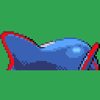 | [`graphics/pokemon/kyogre-back-axp-f-rev0-retail.png`](graphics/pokemon/kyogre-back-axp-f-rev0-retail.png) | French | 128x128 | `e737246afb840858...` |
|  | [`graphics/pokemon/kyogre-back-axp-f-rev1-retail.png`](graphics/pokemon/kyogre-back-axp-f-rev1-retail.png) | French | 128x128 | `e737246afb840858...` |
|  | [`graphics/pokemon/kyogre-front-axp-f-rev0-retail.png`](graphics/pokemon/kyogre-front-axp-f-rev0-retail.png) | French | 128x128 | `6d0b17a5743a73c7...` |
|  | [`graphics/pokemon/kyogre-front-axp-f-rev1-retail.png`](graphics/pokemon/kyogre-front-axp-f-rev1-retail.png) | French | 128x128 | `6d0b17a5743a73c7...` |
|  | [`graphics/pokemon/pikachu-back-axp-f-rev0-retail.png`](graphics/pokemon/pikachu-back-axp-f-rev0-retail.png) | French | 128x128 | `d1472dd2f4862fe9...` |
|  | [`graphics/pokemon/pikachu-back-axp-f-rev1-retail.png`](graphics/pokemon/pikachu-back-axp-f-rev1-retail.png) | French | 128x128 | `d1472dd2f4862fe9...` |
|  | [`graphics/pokemon/pikachu-front-axp-f-rev0-retail.png`](graphics/pokemon/pikachu-front-axp-f-rev0-retail.png) | French | 128x128 | `0be25ad9c369dfb5...` |
|  | [`graphics/pokemon/pikachu-front-axp-f-rev1-retail.png`](graphics/pokemon/pikachu-front-axp-f-rev1-retail.png) | French | 128x128 | `0be25ad9c369dfb5...` |
|  | [`graphics/pokemon/squirtle-back-axp-f-rev0-retail.png`](graphics/pokemon/squirtle-back-axp-f-rev0-retail.png) | French | 128x128 | `c80710c9b72dc8c6...` |
|  | [`graphics/pokemon/squirtle-back-axp-f-rev1-retail.png`](graphics/pokemon/squirtle-back-axp-f-rev1-retail.png) | French | 128x128 | `c80710c9b72dc8c6...` |
|  | [`graphics/pokemon/squirtle-front-axp-f-rev0-retail.png`](graphics/pokemon/squirtle-front-axp-f-rev0-retail.png) | French | 128x128 | `867c957520288232...` |
|  | [`graphics/pokemon/squirtle-front-axp-f-rev1-retail.png`](graphics/pokemon/squirtle-front-axp-f-rev1-retail.png) | French | 128x128 | `867c957520288232...` |
|  | [`graphics/pokemon/venusaur-back-axp-f-rev0-retail.png`](graphics/pokemon/venusaur-back-axp-f-rev0-retail.png) | French | 128x128 | `8467656ef54308b2...` |
| 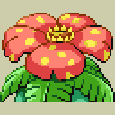 | [`graphics/pokemon/venusaur-back-axp-f-rev1-retail.png`](graphics/pokemon/venusaur-back-axp-f-rev1-retail.png) | French | 128x128 | `8467656ef54308b2...` |
|  | [`graphics/pokemon/venusaur-front-axp-f-rev0-retail.png`](graphics/pokemon/venusaur-front-axp-f-rev0-retail.png) | French | 128x128 | `9c6f9fdb302031aa...` |
|  | [`graphics/pokemon/venusaur-front-axp-f-rev1-retail.png`](graphics/pokemon/venusaur-front-axp-f-rev1-retail.png) | French | 128x128 | `9c6f9fdb302031aa...` |
|  | [`graphics/pokemon/bulbasaur-back-axp-i-rev0-retail.png`](graphics/pokemon/bulbasaur-back-axp-i-rev0-retail.png) | Italian | 128x128 | `a56ef8e9a9b690fc...` |
|  | [`graphics/pokemon/bulbasaur-back-axp-i-rev1-retail.png`](graphics/pokemon/bulbasaur-back-axp-i-rev1-retail.png) | Italian | 128x128 | `a56ef8e9a9b690fc...` |
|  | [`graphics/pokemon/bulbasaur-front-axp-i-rev0-retail.png`](graphics/pokemon/bulbasaur-front-axp-i-rev0-retail.png) | Italian | 128x128 | `8a325c6541282fa7...` |
|  | [`graphics/pokemon/bulbasaur-front-axp-i-rev1-retail.png`](graphics/pokemon/bulbasaur-front-axp-i-rev1-retail.png) | Italian | 128x128 | `8a325c6541282fa7...` |
|  | [`graphics/pokemon/charmander-back-axp-i-rev0-retail.png`](graphics/pokemon/charmander-back-axp-i-rev0-retail.png) | Italian | 128x128 | `0521ce266d4c527f...` |
|  | [`graphics/pokemon/charmander-back-axp-i-rev1-retail.png`](graphics/pokemon/charmander-back-axp-i-rev1-retail.png) | Italian | 128x128 | `0521ce266d4c527f...` |
|  | [`graphics/pokemon/charmander-front-axp-i-rev0-retail.png`](graphics/pokemon/charmander-front-axp-i-rev0-retail.png) | Italian | 128x128 | `c2521fd7f5d54944...` |
|  | [`graphics/pokemon/charmander-front-axp-i-rev1-retail.png`](graphics/pokemon/charmander-front-axp-i-rev1-retail.png) | Italian | 128x128 | `c2521fd7f5d54944...` |
|  | [`graphics/pokemon/ivysaur-back-axp-i-rev0-retail.png`](graphics/pokemon/ivysaur-back-axp-i-rev0-retail.png) | Italian | 128x128 | `57f839867dfb4f04...` |
|  | [`graphics/pokemon/ivysaur-back-axp-i-rev1-retail.png`](graphics/pokemon/ivysaur-back-axp-i-rev1-retail.png) | Italian | 128x128 | `57f839867dfb4f04...` |
|  | [`graphics/pokemon/ivysaur-front-axp-i-rev0-retail.png`](graphics/pokemon/ivysaur-front-axp-i-rev0-retail.png) | Italian | 128x128 | `317ca13389c4a268...` |
|  | [`graphics/pokemon/ivysaur-front-axp-i-rev1-retail.png`](graphics/pokemon/ivysaur-front-axp-i-rev1-retail.png) | Italian | 128x128 | `317ca13389c4a268...` |
|  | [`graphics/pokemon/kyogre-back-axp-i-rev0-retail.png`](graphics/pokemon/kyogre-back-axp-i-rev0-retail.png) | Italian | 128x128 | `e737246afb840858...` |
|  | [`graphics/pokemon/kyogre-back-axp-i-rev1-retail.png`](graphics/pokemon/kyogre-back-axp-i-rev1-retail.png) | Italian | 128x128 | `e737246afb840858...` |
|  | [`graphics/pokemon/kyogre-front-axp-i-rev0-retail.png`](graphics/pokemon/kyogre-front-axp-i-rev0-retail.png) | Italian | 128x128 | `6d0b17a5743a73c7...` |
| 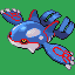 | [`graphics/pokemon/kyogre-front-axp-i-rev1-retail.png`](graphics/pokemon/kyogre-front-axp-i-rev1-retail.png) | Italian | 128x128 | `6d0b17a5743a73c7...` |
|  | [`graphics/pokemon/pikachu-back-axp-i-rev0-retail.png`](graphics/pokemon/pikachu-back-axp-i-rev0-retail.png) | Italian | 128x128 | `d1472dd2f4862fe9...` |
|  | [`graphics/pokemon/pikachu-back-axp-i-rev1-retail.png`](graphics/pokemon/pikachu-back-axp-i-rev1-retail.png) | Italian | 128x128 | `d1472dd2f4862fe9...` |
|  | [`graphics/pokemon/pikachu-front-axp-i-rev0-retail.png`](graphics/pokemon/pikachu-front-axp-i-rev0-retail.png) | Italian | 128x128 | `0be25ad9c369dfb5...` |
|  | [`graphics/pokemon/pikachu-front-axp-i-rev1-retail.png`](graphics/pokemon/pikachu-front-axp-i-rev1-retail.png) | Italian | 128x128 | `0be25ad9c369dfb5...` |
|  | [`graphics/pokemon/squirtle-back-axp-i-rev0-retail.png`](graphics/pokemon/squirtle-back-axp-i-rev0-retail.png) | Italian | 128x128 | `c80710c9b72dc8c6...` |
|  | [`graphics/pokemon/squirtle-back-axp-i-rev1-retail.png`](graphics/pokemon/squirtle-back-axp-i-rev1-retail.png) | Italian | 128x128 | `c80710c9b72dc8c6...` |
|  | [`graphics/pokemon/squirtle-front-axp-i-rev0-retail.png`](graphics/pokemon/squirtle-front-axp-i-rev0-retail.png) | Italian | 128x128 | `867c957520288232...` |
|  | [`graphics/pokemon/squirtle-front-axp-i-rev1-retail.png`](graphics/pokemon/squirtle-front-axp-i-rev1-retail.png) | Italian | 128x128 | `867c957520288232...` |
|  | [`graphics/pokemon/venusaur-back-axp-i-rev0-retail.png`](graphics/pokemon/venusaur-back-axp-i-rev0-retail.png) | Italian | 128x128 | `8467656ef54308b2...` |
|  | [`graphics/pokemon/venusaur-back-axp-i-rev1-retail.png`](graphics/pokemon/venusaur-back-axp-i-rev1-retail.png) | Italian | 128x128 | `8467656ef54308b2...` |
|  | [`graphics/pokemon/venusaur-front-axp-i-rev0-retail.png`](graphics/pokemon/venusaur-front-axp-i-rev0-retail.png) | Italian | 128x128 | `9c6f9fdb302031aa...` |
| 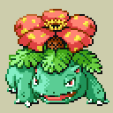 | [`graphics/pokemon/venusaur-front-axp-i-rev1-retail.png`](graphics/pokemon/venusaur-front-axp-i-rev1-retail.png) | Italian | 128x128 | `9c6f9fdb302031aa...` |
|  | [`graphics/pokemon/bulbasaur-back-axp-s-rev0-retail.png`](graphics/pokemon/bulbasaur-back-axp-s-rev0-retail.png) | Spanish | 128x128 | `a56ef8e9a9b690fc...` |
|  | [`graphics/pokemon/bulbasaur-back-axp-s-rev1-retail.png`](graphics/pokemon/bulbasaur-back-axp-s-rev1-retail.png) | Spanish | 128x128 | `a56ef8e9a9b690fc...` |
|  | [`graphics/pokemon/bulbasaur-front-axp-s-rev0-retail.png`](graphics/pokemon/bulbasaur-front-axp-s-rev0-retail.png) | Spanish | 128x128 | `8a325c6541282fa7...` |
|  | [`graphics/pokemon/bulbasaur-front-axp-s-rev1-retail.png`](graphics/pokemon/bulbasaur-front-axp-s-rev1-retail.png) | Spanish | 128x128 | `8a325c6541282fa7...` |
|  | [`graphics/pokemon/charmander-back-axp-s-rev0-retail.png`](graphics/pokemon/charmander-back-axp-s-rev0-retail.png) | Spanish | 128x128 | `0521ce266d4c527f...` |
|  | [`graphics/pokemon/charmander-back-axp-s-rev1-retail.png`](graphics/pokemon/charmander-back-axp-s-rev1-retail.png) | Spanish | 128x128 | `0521ce266d4c527f...` |
|  | [`graphics/pokemon/charmander-front-axp-s-rev0-retail.png`](graphics/pokemon/charmander-front-axp-s-rev0-retail.png) | Spanish | 128x128 | `c2521fd7f5d54944...` |
|  | [`graphics/pokemon/charmander-front-axp-s-rev1-retail.png`](graphics/pokemon/charmander-front-axp-s-rev1-retail.png) | Spanish | 128x128 | `c2521fd7f5d54944...` |
|  | [`graphics/pokemon/ivysaur-back-axp-s-rev0-retail.png`](graphics/pokemon/ivysaur-back-axp-s-rev0-retail.png) | Spanish | 128x128 | `57f839867dfb4f04...` |
|  | [`graphics/pokemon/ivysaur-back-axp-s-rev1-retail.png`](graphics/pokemon/ivysaur-back-axp-s-rev1-retail.png) | Spanish | 128x128 | `57f839867dfb4f04...` |
|  | [`graphics/pokemon/ivysaur-front-axp-s-rev0-retail.png`](graphics/pokemon/ivysaur-front-axp-s-rev0-retail.png) | Spanish | 128x128 | `317ca13389c4a268...` |
| 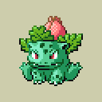 | [`graphics/pokemon/ivysaur-front-axp-s-rev1-retail.png`](graphics/pokemon/ivysaur-front-axp-s-rev1-retail.png) | Spanish | 128x128 | `317ca13389c4a268...` |
|  | [`graphics/pokemon/kyogre-back-axp-s-rev0-retail.png`](graphics/pokemon/kyogre-back-axp-s-rev0-retail.png) | Spanish | 128x128 | `e737246afb840858...` |
|  | [`graphics/pokemon/kyogre-back-axp-s-rev1-retail.png`](graphics/pokemon/kyogre-back-axp-s-rev1-retail.png) | Spanish | 128x128 | `e737246afb840858...` |
|  | [`graphics/pokemon/kyogre-front-axp-s-rev0-retail.png`](graphics/pokemon/kyogre-front-axp-s-rev0-retail.png) | Spanish | 128x128 | `6d0b17a5743a73c7...` |
|  | [`graphics/pokemon/kyogre-front-axp-s-rev1-retail.png`](graphics/pokemon/kyogre-front-axp-s-rev1-retail.png) | Spanish | 128x128 | `6d0b17a5743a73c7...` |
|  | [`graphics/pokemon/pikachu-back-axp-s-rev0-retail.png`](graphics/pokemon/pikachu-back-axp-s-rev0-retail.png) | Spanish | 128x128 | `d1472dd2f4862fe9...` |
|  | [`graphics/pokemon/pikachu-back-axp-s-rev1-retail.png`](graphics/pokemon/pikachu-back-axp-s-rev1-retail.png) | Spanish | 128x128 | `d1472dd2f4862fe9...` |
|  | [`graphics/pokemon/pikachu-front-axp-s-rev0-retail.png`](graphics/pokemon/pikachu-front-axp-s-rev0-retail.png) | Spanish | 128x128 | `0be25ad9c369dfb5...` |
|  | [`graphics/pokemon/pikachu-front-axp-s-rev1-retail.png`](graphics/pokemon/pikachu-front-axp-s-rev1-retail.png) | Spanish | 128x128 | `0be25ad9c369dfb5...` |
|  | [`graphics/pokemon/squirtle-back-axp-s-rev0-retail.png`](graphics/pokemon/squirtle-back-axp-s-rev0-retail.png) | Spanish | 128x128 | `c80710c9b72dc8c6...` |
|  | [`graphics/pokemon/squirtle-back-axp-s-rev1-retail.png`](graphics/pokemon/squirtle-back-axp-s-rev1-retail.png) | Spanish | 128x128 | `c80710c9b72dc8c6...` |
|  | [`graphics/pokemon/squirtle-front-axp-s-rev0-retail.png`](graphics/pokemon/squirtle-front-axp-s-rev0-retail.png) | Spanish | 128x128 | `867c957520288232...` |
|  | [`graphics/pokemon/squirtle-front-axp-s-rev1-retail.png`](graphics/pokemon/squirtle-front-axp-s-rev1-retail.png) | Spanish | 128x128 | `867c957520288232...` |
|  | [`graphics/pokemon/venusaur-back-axp-s-rev0-retail.png`](graphics/pokemon/venusaur-back-axp-s-rev0-retail.png) | Spanish | 128x128 | `8467656ef54308b2...` |
|  | [`graphics/pokemon/venusaur-back-axp-s-rev1-retail.png`](graphics/pokemon/venusaur-back-axp-s-rev1-retail.png) | Spanish | 128x128 | `8467656ef54308b2...` |
|  | [`graphics/pokemon/venusaur-front-axp-s-rev0-retail.png`](graphics/pokemon/venusaur-front-axp-s-rev0-retail.png) | Spanish | 128x128 | `9c6f9fdb302031aa...` |
|  | [`graphics/pokemon/venusaur-front-axp-s-rev1-retail.png`](graphics/pokemon/venusaur-front-axp-s-rev1-retail.png) | Spanish | 128x128 | `9c6f9fdb302031aa...` |

| Palette | Language | Colors | SHA-256 |
| --- | --- | --- | --- |
| [`graphics/pokemon/bulbasaur-axp-j-rev0-retail.pal`](graphics/pokemon/bulbasaur-axp-j-rev0-retail.pal) | Japanese | 16 | `bb3a45b87ac47a26...` |
| [`graphics/pokemon/charmander-axp-j-rev0-retail.pal`](graphics/pokemon/charmander-axp-j-rev0-retail.pal) | Japanese | 16 | `8e0275de21f38209...` |
| [`graphics/pokemon/ivysaur-axp-j-rev0-retail.pal`](graphics/pokemon/ivysaur-axp-j-rev0-retail.pal) | Japanese | 16 | `b33f61ed2e335591...` |
| [`graphics/pokemon/kyogre-axp-j-rev0-retail.pal`](graphics/pokemon/kyogre-axp-j-rev0-retail.pal) | Japanese | 16 | `4c97355083b9c4cf...` |
| [`graphics/pokemon/pikachu-axp-j-rev0-retail.pal`](graphics/pokemon/pikachu-axp-j-rev0-retail.pal) | Japanese | 16 | `066a8707fdfbf027...` |
| [`graphics/pokemon/squirtle-axp-j-rev0-retail.pal`](graphics/pokemon/squirtle-axp-j-rev0-retail.pal) | Japanese | 16 | `90702f2e5e66ce90...` |
| [`graphics/pokemon/venusaur-axp-j-rev0-retail.pal`](graphics/pokemon/venusaur-axp-j-rev0-retail.pal) | Japanese | 16 | `11606f5afc78f891...` |
| [`graphics/pokemon/bulbasaur-axp-e-rev0-retail.pal`](graphics/pokemon/bulbasaur-axp-e-rev0-retail.pal) | English | 16 | `bb3a45b87ac47a26...` |
| [`graphics/pokemon/bulbasaur-axp-e-rev1-retail.pal`](graphics/pokemon/bulbasaur-axp-e-rev1-retail.pal) | English | 16 | `bb3a45b87ac47a26...` |
| [`graphics/pokemon/bulbasaur-axp-e-rev2-retail.pal`](graphics/pokemon/bulbasaur-axp-e-rev2-retail.pal) | English | 16 | `bb3a45b87ac47a26...` |
| [`graphics/pokemon/charmander-axp-e-rev0-retail.pal`](graphics/pokemon/charmander-axp-e-rev0-retail.pal) | English | 16 | `8e0275de21f38209...` |
| [`graphics/pokemon/charmander-axp-e-rev1-retail.pal`](graphics/pokemon/charmander-axp-e-rev1-retail.pal) | English | 16 | `8e0275de21f38209...` |
| [`graphics/pokemon/charmander-axp-e-rev2-retail.pal`](graphics/pokemon/charmander-axp-e-rev2-retail.pal) | English | 16 | `8e0275de21f38209...` |
| [`graphics/pokemon/ivysaur-axp-e-rev0-retail.pal`](graphics/pokemon/ivysaur-axp-e-rev0-retail.pal) | English | 16 | `b33f61ed2e335591...` |
| [`graphics/pokemon/ivysaur-axp-e-rev1-retail.pal`](graphics/pokemon/ivysaur-axp-e-rev1-retail.pal) | English | 16 | `b33f61ed2e335591...` |
| [`graphics/pokemon/ivysaur-axp-e-rev2-retail.pal`](graphics/pokemon/ivysaur-axp-e-rev2-retail.pal) | English | 16 | `b33f61ed2e335591...` |
| [`graphics/pokemon/kyogre-axp-e-rev0-retail.pal`](graphics/pokemon/kyogre-axp-e-rev0-retail.pal) | English | 16 | `4c97355083b9c4cf...` |
| [`graphics/pokemon/kyogre-axp-e-rev1-retail.pal`](graphics/pokemon/kyogre-axp-e-rev1-retail.pal) | English | 16 | `4c97355083b9c4cf...` |
| [`graphics/pokemon/kyogre-axp-e-rev2-retail.pal`](graphics/pokemon/kyogre-axp-e-rev2-retail.pal) | English | 16 | `4c97355083b9c4cf...` |
| [`graphics/pokemon/pikachu-axp-e-rev0-retail.pal`](graphics/pokemon/pikachu-axp-e-rev0-retail.pal) | English | 16 | `066a8707fdfbf027...` |
| [`graphics/pokemon/pikachu-axp-e-rev1-retail.pal`](graphics/pokemon/pikachu-axp-e-rev1-retail.pal) | English | 16 | `066a8707fdfbf027...` |
| [`graphics/pokemon/pikachu-axp-e-rev2-retail.pal`](graphics/pokemon/pikachu-axp-e-rev2-retail.pal) | English | 16 | `066a8707fdfbf027...` |
| [`graphics/pokemon/squirtle-axp-e-rev0-retail.pal`](graphics/pokemon/squirtle-axp-e-rev0-retail.pal) | English | 16 | `90702f2e5e66ce90...` |
| [`graphics/pokemon/squirtle-axp-e-rev1-retail.pal`](graphics/pokemon/squirtle-axp-e-rev1-retail.pal) | English | 16 | `90702f2e5e66ce90...` |
| [`graphics/pokemon/squirtle-axp-e-rev2-retail.pal`](graphics/pokemon/squirtle-axp-e-rev2-retail.pal) | English | 16 | `90702f2e5e66ce90...` |
| [`graphics/pokemon/venusaur-axp-e-rev0-retail.pal`](graphics/pokemon/venusaur-axp-e-rev0-retail.pal) | English | 16 | `11606f5afc78f891...` |
| [`graphics/pokemon/venusaur-axp-e-rev1-retail.pal`](graphics/pokemon/venusaur-axp-e-rev1-retail.pal) | English | 16 | `11606f5afc78f891...` |
| [`graphics/pokemon/venusaur-axp-e-rev2-retail.pal`](graphics/pokemon/venusaur-axp-e-rev2-retail.pal) | English | 16 | `11606f5afc78f891...` |
| [`graphics/pokemon/bulbasaur-axp-d-rev0-retail.pal`](graphics/pokemon/bulbasaur-axp-d-rev0-retail.pal) | German | 16 | `bb3a45b87ac47a26...` |
| [`graphics/pokemon/bulbasaur-axp-d-rev1-retail.pal`](graphics/pokemon/bulbasaur-axp-d-rev1-retail.pal) | German | 16 | `bb3a45b87ac47a26...` |
| [`graphics/pokemon/charmander-axp-d-rev0-retail.pal`](graphics/pokemon/charmander-axp-d-rev0-retail.pal) | German | 16 | `8e0275de21f38209...` |
| [`graphics/pokemon/charmander-axp-d-rev1-retail.pal`](graphics/pokemon/charmander-axp-d-rev1-retail.pal) | German | 16 | `8e0275de21f38209...` |
| [`graphics/pokemon/ivysaur-axp-d-rev0-retail.pal`](graphics/pokemon/ivysaur-axp-d-rev0-retail.pal) | German | 16 | `b33f61ed2e335591...` |
| [`graphics/pokemon/ivysaur-axp-d-rev1-retail.pal`](graphics/pokemon/ivysaur-axp-d-rev1-retail.pal) | German | 16 | `b33f61ed2e335591...` |
| [`graphics/pokemon/kyogre-axp-d-rev0-retail.pal`](graphics/pokemon/kyogre-axp-d-rev0-retail.pal) | German | 16 | `4c97355083b9c4cf...` |
| [`graphics/pokemon/kyogre-axp-d-rev1-retail.pal`](graphics/pokemon/kyogre-axp-d-rev1-retail.pal) | German | 16 | `4c97355083b9c4cf...` |
| [`graphics/pokemon/pikachu-axp-d-rev0-retail.pal`](graphics/pokemon/pikachu-axp-d-rev0-retail.pal) | German | 16 | `066a8707fdfbf027...` |
| [`graphics/pokemon/pikachu-axp-d-rev1-retail.pal`](graphics/pokemon/pikachu-axp-d-rev1-retail.pal) | German | 16 | `066a8707fdfbf027...` |
| [`graphics/pokemon/squirtle-axp-d-rev0-retail.pal`](graphics/pokemon/squirtle-axp-d-rev0-retail.pal) | German | 16 | `90702f2e5e66ce90...` |
| [`graphics/pokemon/squirtle-axp-d-rev1-retail.pal`](graphics/pokemon/squirtle-axp-d-rev1-retail.pal) | German | 16 | `90702f2e5e66ce90...` |
| [`graphics/pokemon/venusaur-axp-d-rev0-retail.pal`](graphics/pokemon/venusaur-axp-d-rev0-retail.pal) | German | 16 | `11606f5afc78f891...` |
| [`graphics/pokemon/venusaur-axp-d-rev1-retail.pal`](graphics/pokemon/venusaur-axp-d-rev1-retail.pal) | German | 16 | `11606f5afc78f891...` |
| [`graphics/pokemon/bulbasaur-axp-f-rev0-retail.pal`](graphics/pokemon/bulbasaur-axp-f-rev0-retail.pal) | French | 16 | `bb3a45b87ac47a26...` |
| [`graphics/pokemon/bulbasaur-axp-f-rev1-retail.pal`](graphics/pokemon/bulbasaur-axp-f-rev1-retail.pal) | French | 16 | `bb3a45b87ac47a26...` |
| [`graphics/pokemon/charmander-axp-f-rev0-retail.pal`](graphics/pokemon/charmander-axp-f-rev0-retail.pal) | French | 16 | `8e0275de21f38209...` |
| [`graphics/pokemon/charmander-axp-f-rev1-retail.pal`](graphics/pokemon/charmander-axp-f-rev1-retail.pal) | French | 16 | `8e0275de21f38209...` |
| [`graphics/pokemon/ivysaur-axp-f-rev0-retail.pal`](graphics/pokemon/ivysaur-axp-f-rev0-retail.pal) | French | 16 | `b33f61ed2e335591...` |
| [`graphics/pokemon/ivysaur-axp-f-rev1-retail.pal`](graphics/pokemon/ivysaur-axp-f-rev1-retail.pal) | French | 16 | `b33f61ed2e335591...` |
| [`graphics/pokemon/kyogre-axp-f-rev0-retail.pal`](graphics/pokemon/kyogre-axp-f-rev0-retail.pal) | French | 16 | `4c97355083b9c4cf...` |
| [`graphics/pokemon/kyogre-axp-f-rev1-retail.pal`](graphics/pokemon/kyogre-axp-f-rev1-retail.pal) | French | 16 | `4c97355083b9c4cf...` |
| [`graphics/pokemon/pikachu-axp-f-rev0-retail.pal`](graphics/pokemon/pikachu-axp-f-rev0-retail.pal) | French | 16 | `066a8707fdfbf027...` |
| [`graphics/pokemon/pikachu-axp-f-rev1-retail.pal`](graphics/pokemon/pikachu-axp-f-rev1-retail.pal) | French | 16 | `066a8707fdfbf027...` |
| [`graphics/pokemon/squirtle-axp-f-rev0-retail.pal`](graphics/pokemon/squirtle-axp-f-rev0-retail.pal) | French | 16 | `90702f2e5e66ce90...` |
| [`graphics/pokemon/squirtle-axp-f-rev1-retail.pal`](graphics/pokemon/squirtle-axp-f-rev1-retail.pal) | French | 16 | `90702f2e5e66ce90...` |
| [`graphics/pokemon/venusaur-axp-f-rev0-retail.pal`](graphics/pokemon/venusaur-axp-f-rev0-retail.pal) | French | 16 | `11606f5afc78f891...` |
| [`graphics/pokemon/venusaur-axp-f-rev1-retail.pal`](graphics/pokemon/venusaur-axp-f-rev1-retail.pal) | French | 16 | `11606f5afc78f891...` |
| [`graphics/pokemon/bulbasaur-axp-i-rev0-retail.pal`](graphics/pokemon/bulbasaur-axp-i-rev0-retail.pal) | Italian | 16 | `bb3a45b87ac47a26...` |
| [`graphics/pokemon/bulbasaur-axp-i-rev1-retail.pal`](graphics/pokemon/bulbasaur-axp-i-rev1-retail.pal) | Italian | 16 | `bb3a45b87ac47a26...` |
| [`graphics/pokemon/charmander-axp-i-rev0-retail.pal`](graphics/pokemon/charmander-axp-i-rev0-retail.pal) | Italian | 16 | `8e0275de21f38209...` |
| [`graphics/pokemon/charmander-axp-i-rev1-retail.pal`](graphics/pokemon/charmander-axp-i-rev1-retail.pal) | Italian | 16 | `8e0275de21f38209...` |
| [`graphics/pokemon/ivysaur-axp-i-rev0-retail.pal`](graphics/pokemon/ivysaur-axp-i-rev0-retail.pal) | Italian | 16 | `b33f61ed2e335591...` |
| [`graphics/pokemon/ivysaur-axp-i-rev1-retail.pal`](graphics/pokemon/ivysaur-axp-i-rev1-retail.pal) | Italian | 16 | `b33f61ed2e335591...` |
| [`graphics/pokemon/kyogre-axp-i-rev0-retail.pal`](graphics/pokemon/kyogre-axp-i-rev0-retail.pal) | Italian | 16 | `4c97355083b9c4cf...` |
| [`graphics/pokemon/kyogre-axp-i-rev1-retail.pal`](graphics/pokemon/kyogre-axp-i-rev1-retail.pal) | Italian | 16 | `4c97355083b9c4cf...` |
| [`graphics/pokemon/pikachu-axp-i-rev0-retail.pal`](graphics/pokemon/pikachu-axp-i-rev0-retail.pal) | Italian | 16 | `066a8707fdfbf027...` |
| [`graphics/pokemon/pikachu-axp-i-rev1-retail.pal`](graphics/pokemon/pikachu-axp-i-rev1-retail.pal) | Italian | 16 | `066a8707fdfbf027...` |
| [`graphics/pokemon/squirtle-axp-i-rev0-retail.pal`](graphics/pokemon/squirtle-axp-i-rev0-retail.pal) | Italian | 16 | `90702f2e5e66ce90...` |
| [`graphics/pokemon/squirtle-axp-i-rev1-retail.pal`](graphics/pokemon/squirtle-axp-i-rev1-retail.pal) | Italian | 16 | `90702f2e5e66ce90...` |
| [`graphics/pokemon/venusaur-axp-i-rev0-retail.pal`](graphics/pokemon/venusaur-axp-i-rev0-retail.pal) | Italian | 16 | `11606f5afc78f891...` |
| [`graphics/pokemon/venusaur-axp-i-rev1-retail.pal`](graphics/pokemon/venusaur-axp-i-rev1-retail.pal) | Italian | 16 | `11606f5afc78f891...` |
| [`graphics/pokemon/bulbasaur-axp-s-rev0-retail.pal`](graphics/pokemon/bulbasaur-axp-s-rev0-retail.pal) | Spanish | 16 | `bb3a45b87ac47a26...` |
| [`graphics/pokemon/bulbasaur-axp-s-rev1-retail.pal`](graphics/pokemon/bulbasaur-axp-s-rev1-retail.pal) | Spanish | 16 | `bb3a45b87ac47a26...` |
| [`graphics/pokemon/charmander-axp-s-rev0-retail.pal`](graphics/pokemon/charmander-axp-s-rev0-retail.pal) | Spanish | 16 | `8e0275de21f38209...` |
| [`graphics/pokemon/charmander-axp-s-rev1-retail.pal`](graphics/pokemon/charmander-axp-s-rev1-retail.pal) | Spanish | 16 | `8e0275de21f38209...` |
| [`graphics/pokemon/ivysaur-axp-s-rev0-retail.pal`](graphics/pokemon/ivysaur-axp-s-rev0-retail.pal) | Spanish | 16 | `b33f61ed2e335591...` |
| [`graphics/pokemon/ivysaur-axp-s-rev1-retail.pal`](graphics/pokemon/ivysaur-axp-s-rev1-retail.pal) | Spanish | 16 | `b33f61ed2e335591...` |
| [`graphics/pokemon/kyogre-axp-s-rev0-retail.pal`](graphics/pokemon/kyogre-axp-s-rev0-retail.pal) | Spanish | 16 | `4c97355083b9c4cf...` |
| [`graphics/pokemon/kyogre-axp-s-rev1-retail.pal`](graphics/pokemon/kyogre-axp-s-rev1-retail.pal) | Spanish | 16 | `4c97355083b9c4cf...` |
| [`graphics/pokemon/pikachu-axp-s-rev0-retail.pal`](graphics/pokemon/pikachu-axp-s-rev0-retail.pal) | Spanish | 16 | `066a8707fdfbf027...` |
| [`graphics/pokemon/pikachu-axp-s-rev1-retail.pal`](graphics/pokemon/pikachu-axp-s-rev1-retail.pal) | Spanish | 16 | `066a8707fdfbf027...` |
| [`graphics/pokemon/squirtle-axp-s-rev0-retail.pal`](graphics/pokemon/squirtle-axp-s-rev0-retail.pal) | Spanish | 16 | `90702f2e5e66ce90...` |
| [`graphics/pokemon/squirtle-axp-s-rev1-retail.pal`](graphics/pokemon/squirtle-axp-s-rev1-retail.pal) | Spanish | 16 | `90702f2e5e66ce90...` |
| [`graphics/pokemon/venusaur-axp-s-rev0-retail.pal`](graphics/pokemon/venusaur-axp-s-rev0-retail.pal) | Spanish | 16 | `11606f5afc78f891...` |
| [`graphics/pokemon/venusaur-axp-s-rev1-retail.pal`](graphics/pokemon/venusaur-axp-s-rev1-retail.pal) | Spanish | 16 | `11606f5afc78f891...` |

Every entry is tied to at least one existing analysis or manifest record. Full hashes and provenance links are in `analysis/public-graphics-catalog.json`.
